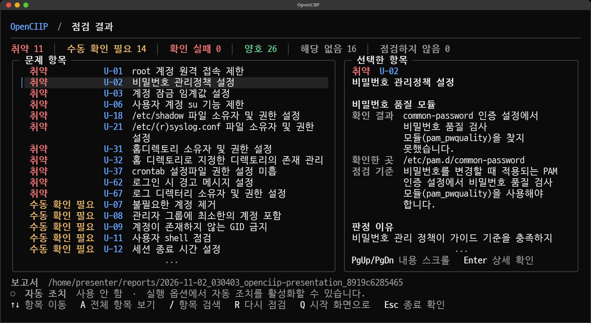

# OpenCIIP

Linux 서버의 보안 설정을 점검하고 결과를 정리하는 터미널 도구입니다. 주요정보통신기반시설 기술적 취약점 분석·평가 방법 상세가이드의 Unix 서버 항목을 기준으로 합니다.

[](https://go.dev/) [](https://www.kernel.org/) [](https://github.com/charmbracelet/bubbletea) [](https://github.com/spf13/cobra) [](LICENSE)

[빠른 시작](#빠른-시작) · [점검 결과](#점검-결과) · [지원 환경](#지원-환경) · [자동 조치](#자동-조치) · [문서](#문서)



<sub>점검 결과 화면 예시 · 개발 중인 버전</sub>

## 주요 기능

- U-01부터 U-67까지 서버 설정을 읽기 전용으로 점검합니다.
- 터미널 화면에서 항목별 확인 결과와 점검 기준을 살펴볼 수 있습니다.
- CLI로 전체 항목이나 필요한 항목만 선택해 점검할 수 있습니다.
- JSON과 텍스트 보고서를 생성하며 민감정보는 기본적으로 가립니다.
- 지원 환경에서 일부 취약 항목의 변경 계획과 자동 조치를 제공합니다.

## 빠른 시작

[Releases](https://github.com/yesidodo73/OpenCIIP/releases)에서 `openciip-linux-amd64`를 내려받습니다. 실행 파일에 점검 규칙이 포함되어 있으므로 서버에 Go나 별도 규칙 파일을 설치할 필요는 없습니다.

실행 권한을 부여한 뒤 터미널 화면을 시작합니다.

```bash
chmod +x ./openciip-linux-amd64
sudo ./openciip-linux-amd64
```

CLI에서 정상 항목을 포함한 전체 결과를 확인하려면 다음과 같이 실행합니다.

```bash
sudo ./openciip-linux-amd64 scan --all
```

특정 항목만 점검할 수도 있습니다.

```bash
sudo ./openciip-linux-amd64 scan --check U-01,U-02,U-03
```

root 권한이 없으면 보호된 설정과 시스템 상태를 확인하지 못할 수 있습니다. 옵션과 종료 코드는 [사용 방법](docs/USAGE.md)에서 확인하세요.

## 점검 결과

| 화면과 TXT 표시 | JSON 상태 코드 | 의미 |
| --- | --- | --- |
| `양호` | `PASS` | 점검 기준을 충족합니다. |
| `취약` | `FAIL` | 점검 기준을 충족하지 않습니다. |
| `수동 확인 필요` | `UNKNOWN` | 현재 정보만으로 판단하기 어렵습니다. |
| `확인 실패` | `ERROR` | 권한, 명령 실행 또는 설정 해석 중 오류가 발생했습니다. |
| `해당 없음` | `NOT_APPLICABLE` | 해당 기능이나 서비스가 사용되지 않습니다. |
| `점검하지 않음` | `SKIPPED` | 사용자가 점검에서 제외했습니다. |

기본 화면에는 확인이 필요한 항목만 표시합니다. 보고서는 기본적으로 현재 디렉터리의 `reports/`에 저장됩니다. 비밀번호, 해시, 토큰, 개인 키 등은 기본적으로 가려지며, 마스킹을 해제한 보고서는 공유하지 마세요.

## 지원 환경

읽기 전용 점검은 Linux에서 실행할 수 있으며 배포판과 설정에 따라 일부 항목은 `수동 확인 필요` 또는 `해당 없음`으로 표시될 수 있습니다. 아래 amd64 환경에서는 `0.1.0` 버전으로 67개 항목의 전체 읽기 전용 점검을 완료했습니다.

| 운영체제 | 버전 | 아키텍처 | 점검 상태 |
| --- | --- | --- | --- |
| Rocky Linux | 9.5 | amd64 | 테스트 완료 |
| Rocky Linux | 9.6 | amd64 | 테스트 완료 |
| Rocky Linux | 9.7 | amd64 | 테스트 완료 |
| Rocky Linux | 9.8 | amd64 | 테스트 완료 |
| Ubuntu | 18.04 LTS | amd64 | 테스트 완료 |
| Ubuntu | 20.04 LTS | amd64 | 테스트 완료 |
| Ubuntu | 22.04 LTS | amd64 | 테스트 완료 |
| Ubuntu | 24.04 LTS | amd64 | 테스트 완료 |
| Ubuntu | 26.04 LTS | amd64 | 테스트 완료 |
| CentOS Linux | 8.5.2111 | amd64 | 테스트 완료 |

전체 점검 완료는 읽기 전용 점검을 기준으로 하며 자동 조치 지원 여부와는 별개입니다. 자세한 점검 범위는 [점검 문서](docs/CHECKS.md)를 확인하세요.

## 자동 조치

위 환경에서는 U-19, U-22, U-29의 자동 조치를 지원합니다. 다른 항목은 자동 조치 대상이 아닙니다. `0.1.0`에서는 세 항목의 적용 후 재점검과 실행 전체 롤백, 재부팅 후 실행 전체 롤백을 확인했습니다. 항목별 롤백은 U-22에서 확인했습니다.

현재 소스에서는 수정되지 않은 사전 릴리스 빌드도 사용할 수 있습니다. 수정된 `+dirty` 빌드에서는 실제 조치와 사용자 요청 롤백이 차단됩니다. 이전 릴리스의 동작은 다를 수 있습니다.

> [!WARNING]
> 자동 조치는 실제 시스템의 파일 소유자나 권한을 변경합니다. 테스트를 마쳤더라도 서버마다 서비스 구성과 사용 방식이 다르므로 실제 영향이 달라질 수 있습니다. 적용 전에 점검 결과와 변경 대상, dry-run 내용, 백업과 롤백 가능 여부를 확인하고 신중하게 선택하세요.

OpenCIIP의 결과는 기술적인 점검 자료입니다. 조직의 예외 정책, 자산 범위와 보완 통제를 포함한 최종 보안 판단은 별도로 확인하세요.

## 문서

- [사용 방법](docs/USAGE.md): 실행 옵션, 보고서와 종료 코드
- [점검 범위와 결과](docs/CHECKS.md): 점검 분류, 결과 상태와 테스트 환경
- [기여하기](CONTRIBUTING.md): 소스 빌드와 변경 검증
- [보안 정책](SECURITY.md): 취약점 신고 방법

취약점을 발견했다면 공개 이슈에 세부 내용을 올리지 말고 보안 정책의 신고 방법을 이용해주세요.

## 라이선스

[Apache License 2.0](LICENSE)
