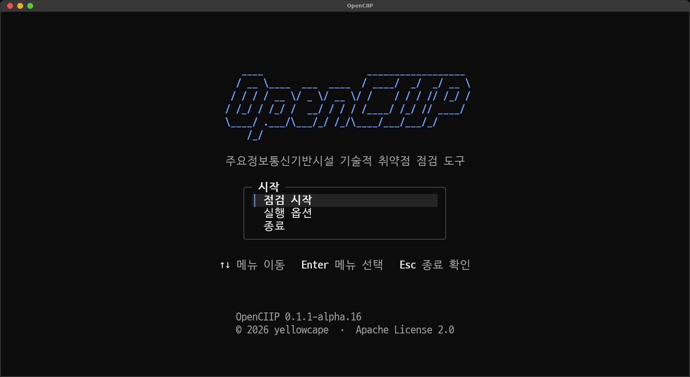
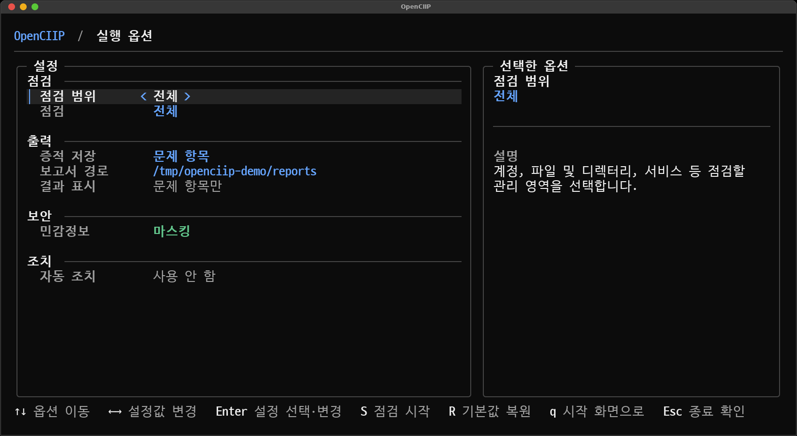

<div align="center">

# OpenCIIP

OpenCIIP는 [주요정보통신기반시설 기술적 취약점 분석·평가 방법 상세가이드](https://www.kisa.or.kr/2060204/form?postSeq=22)의 Unix 서버 항목을 기반으로 Linux 서버의 보안 설정을 점검하는 도구입니다.

[](https://go.dev/) [](https://www.kernel.org/) [](https://github.com/charmbracelet/bubbletea) [](https://github.com/spf13/cobra) [](LICENSE)

[시작하기](#시작하기) · [점검 결과](#점검-결과) · [지원 환경](#지원-환경) · [자동 조치](#자동-조치) · [문서](#문서)



</div>

## 주요 기능

- 전체 또는 선택 항목 점검
- 각 항목의 판정 결과, 관련 설정 및 점검 기준 조회
- JSON 및 텍스트 보고서 생성, 민감정보 기본 마스킹
- 자동 조치 (현재 일부 항목만 지원)

기본 점검은 시스템 설정을 변경하지 않는 읽기 전용 방식으로 수행됩니다.

## 시작하기

[Releases](https://github.com/yesidodo73/OpenCIIP/releases)에서 `openciip-linux-amd64`를 다운로드하고 실행 권한을 부여합니다. 점검 규칙은 실행 파일에 포함되어 있습니다.

```bash
chmod +x ./openciip-linux-amd64
sudo ./openciip-linux-amd64
```

시작 화면에서 `점검 시작`을 선택하면 전체 항목을 점검합니다. 점검할 항목이나 보고서 저장 경로, 증적 저장 범위 등은 `실행 옵션`에서 변경할 수 있습니다.



root 권한 없이 실행할 수도 있지만, 일부 시스템 설정에 접근하지 못해 점검이 제한될 수 있습니다.

실행 옵션에 관한 자세한 내용은 [사용 방법](docs/USAGE.md)을 참고하세요.

## 점검 결과

점검이 끝나면 결과 목록에서 각 항목의 판정 상태를 확인할 수 있습니다. 항목을 선택하고 `Enter`를 누르면 실제로 확인한 설정과 점검 기준을 볼 수 있습니다.


보고서는 기본적으로 현재 디렉터리의 `reports/`에 저장됩니다. 비밀번호, 해시, 토큰, 개인 키 등 민감정보는 기본적으로 가려지며, 마스킹을 해제한 보고서를 외부에 공유하지 않도록 주의해야 합니다.

터미널 UI를 사용하지 않고 명령줄에서 바로 점검할 수도 있습니다.

```bash
sudo ./openciip-linux-amd64 scan --all
sudo ./openciip-linux-amd64 scan --check U-01,U-02,U-03
```

## 지원 환경

OpenCIIP의 읽기 전용 점검 기능은 Linux에서 사용할 수 있습니다. 배포판과 시스템 구성에 따라 일부 항목은 `수동 확인 필요` 또는 `해당 없음`으로 판정될 수 있습니다.

다음 Linux amd64 환경에서 `0.1.0` 버전으로 67개 항목의 전체 점검을 완료했습니다.

| 운영체제 | 테스트 버전 |
| --- | --- |
| Rocky Linux | 9.5, 9.6, 9.7, 9.8 |
| Ubuntu | 18.04 LTS, 20.04 LTS, 22.04 LTS, 24.04 LTS, 26.04 LTS |
| CentOS Linux | 8.5.2111 |

항목별 점검 기준과 결과 분류는 [점검 범위와 결과](docs/CHECKS.md)에 정리되어 있습니다.

## 자동 조치

현재 U-19, U-22, U-29의 파일 소유자와 권한을 조치할 수 있습니다. 적용 전에는 변경 계획을 확인하고 승인해야 합니다.

> [!WARNING]
> 자동 조치는 아직 개발 중인 기능입니다. 예상하지 못한 버그나 시스템 환경에 따른 문제로 파일 소유자 및 권한이 잘못 변경되거나 서비스 장애가 발생할 수 있습니다. 실행 전에 변경 내용을 확인하고 중요한 데이터를 백업하는 것을 권장합니다.

테스트 범위와 주의사항은 [점검 범위와 결과](docs/CHECKS.md#자동-조치)에서 확인할 수 있습니다.

## 문서

- [사용 방법](docs/USAGE.md) — 실행 옵션, 보고서 및 종료 코드
- [점검 범위와 결과](docs/CHECKS.md) — 점검 분류, 결과 상태 및 테스트 환경
- [기여하기](CONTRIBUTING.md) — 소스 빌드 및 변경 검증
- [보안 정책](SECURITY.md) — 취약점 신고 방법

## 라이선스

[Apache License 2.0](LICENSE)
